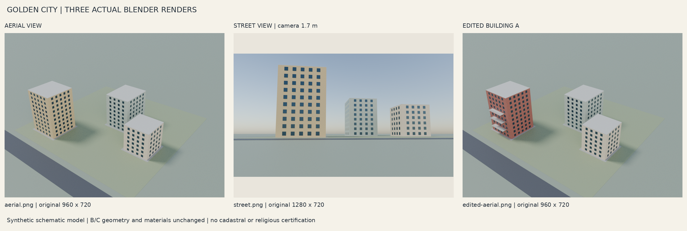

# Golden City — ניסוי מסירה סינתטי

התמונות והמודל כאן הם תוצרי ניסוי סינתטי קיימים. הקבצים המקוריים נשמרו ללא רינדור מחדש וללא שינוי בגיאומטריה.

## צפייה והורדה

לחצו על שם תמונה כדי לצפות בה דרך GitHub. להורדה, פתחו את דף הקובץ ולחצו על Download raw file או סמל ההורדה. אפשר גם לשמור את התמונה מתוך הדפדפן.

- [מבט אווירי](aerial.png)
- [מבט מגובה הרחוב](street.png)
- [לאחר שינוי נקודתי במבנה A](edited-aerial.png)
- [גיליון תצוגה מקדימה](contact-sheet.png)
- [גלריה עצמאית להורדה](golden-city-gallery.html)
- [מודל תלת־ממדי אינטראקטיבי להורדה](golden-city-viewer.html)

## פתיחת הגלריה והמודל

הורידו את קובץ HTML עצמו, ואז בחרו ״פתח באמצעות״ Chrome או Edge עדכני. דף הקוד ב־GitHub מציג את קוד HTML. בגלריה אפשר לראות ולשמור את התמונות המקוריות. קובץ golden-city-viewer.html מכיל את התמונות והמודל הסינתטי: גרירת עכבר מסובבת את המצלמה, גלגלת מגדילה ומקטינה, והכפתורים בוחרים מבט אווירי או מבט רחוב.

הקבצים עצמאיים ופועלים ללא שרת או חיבור לרשת. מודולי Three.js בקובץ הצפייה כוללים את הודעת רישיון MIT.

## תקינות

התמונות נפתחו מחדש ופוענחו באמצעות Pillow ו־FFmpeg. התמונות המשובצות וקובצי HTML נבדקו בנפרד; חתימות SHA-256 וגודלי הקבצים נמצאים ב־manifest.json. נתוני הגלריה הטכניים מתעדים בדיקות קודמות בזמן שבו הוכנו; manifest.json מתאר את קובצי המסירה הנוכחיים.

נגישות במחשב המקבלת דורשת אישור בפועל. בדיקת קבצים בסביבת הענן אינה מוכיחה שהמחשב או הדפדפן שלה פתחו אותם.
